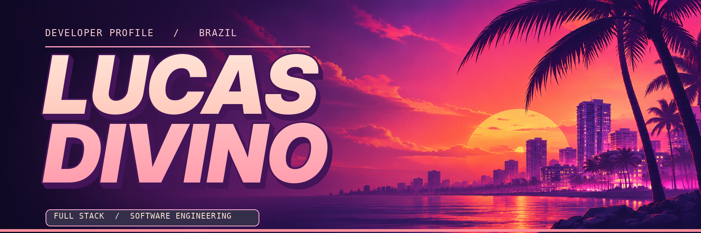
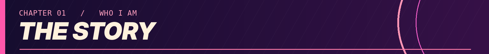
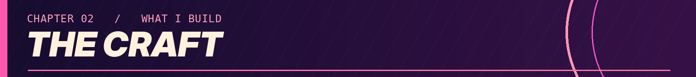
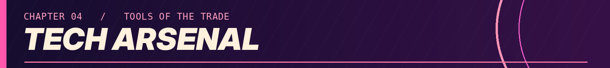
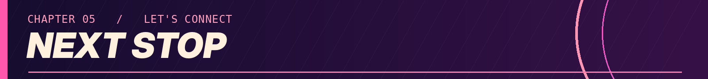
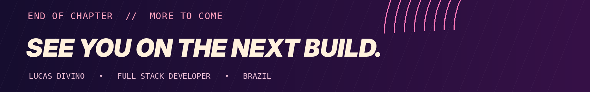

 

**SOFTWARE ENGINEERING &nbsp; • &nbsp; DIGITAL EXPERIENCES &nbsp; • &nbsp; BUILDING WHAT'S NEXT**

 

FULL STACK DEVELOPER &nbsp; / &nbsp; BRAZIL

 

### From idea to production.

Sou **Lucas Divino**, desenvolvedor **Full Stack** com foco em transformar ideias em produtos digitais — da interface à API, do banco de dados ao deploy.

Trabalho com **aplicações web, plataformas SaaS, e-commerce, integrações entre sistemas, automações e ferramentas para desenvolvedores**. Valorizo arquitetura bem pensada, interfaces eficientes e soluções que possam crescer sem perder simplicidade.

> I don't just write code. I build things that work.

 

| **01 — PRODUCT ENGINEERING** | **02 — COMMERCE & INTEGRATIONS** |
| :--- | :--- |
| Arquitetura de SaaS, aplicações multi-tenant, autenticação, assinaturas e APIs. | Storefronts, catálogos, pedidos e comunicação entre plataformas e ERPs. |
| **03 — DEVELOPER TOOLING** | **04 — DESIGN & EXPERIENCE** |
| Apps desktop, CLIs, automações e ferramentas que tornam fluxos mais produtivos. | Interfaces, editores e experiências digitais com atenção à usabilidade e identidade visual. |

 

| Área | Tecnologias |
| :--- | :--- |
| **Frontend** | TypeScript · JavaScript · React · Next.js · Vite · HTML · CSS |
| **Backend** | Node.js · Express · APIs REST · autenticação · integrações |
| **Banco de dados** | MongoDB · PostgreSQL · SQL |
| **Desktop & tooling** | Electron · Git · Linux · CLI |
| **Cloud & deploy** | Vercel · Railway · Cloudflare |
| **Commerce & payments** | Tray · VTEX · Wake · TOTVS · Stripe · Mercado Pago |

 

### The next destination is under construction.

Um portfólio interativo está nos planos: um espaço para explorar meu trabalho, experimentos e experiências visuais além do GitHub.

 

<a href="https://github.com/TKLucas"><b>GITHUB PROFILE ↗</b></a>
&nbsp; • &nbsp;
<b>PORTFOLIO — COMING SOON</b>

  

